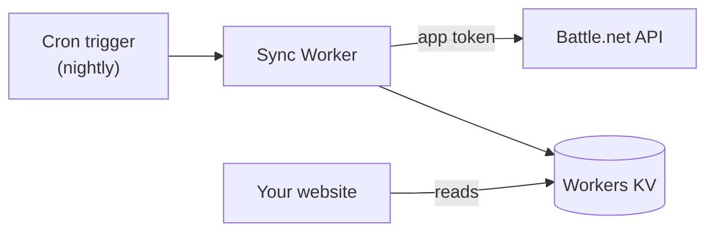

# wow-armoury-sync

A small Cloudflare Worker that copies your World of Warcraft characters from Blizzard's Battle.net API into Cloudflare Workers KV once a night. A website can then show them in an Armory-style view without calling Blizzard on every page load.

It handles both **retail** and **WoW Forever** characters. It powers the armoury pages on [nerdz.cloud](https://nerdz.cloud).

## How it works



1. Cloudflare wakes the Worker on a schedule. There's no public URL: any web request gets a 404.
2. The Worker gets an app token from Battle.net using the client credentials flow, so no player login is involved.
3. For each character it fetches the profile, then fetches these sections in parallel: equipment, specialisations, professions, reputations, character media and statistics.
4. It writes everything to KV, plus an index your site can use to list characters.

A bad night never wipes good data. If Blizzard's API fails, the character's previous record is kept and marked with the error.

## What gets stored

| KV key | Contents |
| --- | --- |
| `index` | `updatedAt` plus one summary per character (see below) |
| `character:{key}` | The full record: `fetchedAt`, `profile`, `equipment`, `specializations`, `professions`, `reputations`, `media`, `statistics`, `itemIcons` |
| `icon:{namespace}:{itemId}` | An item's icon URL. Icons never change, so each is fetched once and reused. |

A summary in `index` looks like this:

```json
{
  "key": "forever:us:recurve-ravenholt",
  "game": "forever",
  "status": "ok",
  "name": "Recurve",
  "realm": null,
  "level": 23,
  "race": "High Order Skyborne",
  "characterClass": "Hunter",
  "spec": null,
  "faction": "Alliance",
  "itemLevel": 11,
  "lastSuccessAt": "2026-11-16T01:26:10.236Z"
}
```

`status` is one of:

| Status | Meaning |
| --- | --- |
| `ok` | Synced on the latest run |
| `not-listed` | Blizzard doesn't list the character (yet). WoW Forever characters only appear from **level 10**, after logging out. The sync tries again each night. |
| `error` | The API call failed. The previous record and summary are kept, with an `error` message added. |

The record's sections are the raw Battle.net responses. A section the API doesn't return is stored as `null`, and one missing section doesn't stop the rest of the character from being stored. `itemIcons` maps each equipped item's ID to its icon URL.

## Set up your own

You need a [Cloudflare](https://dash.cloudflare.com/) account, [Node.js](https://nodejs.org/) 20 or newer, and a Battle.net account.

### 1. Create a Battle.net API client

1. Sign in to the [Blizzard developer portal](https://develop.battle.net/access/clients) and create a client.
2. You can set the redirect URL to anything, because this Worker never uses the login flow.
3. Keep the **Client ID** and **Client Secret** for step 4.

### 2. Get the code

```sh
git clone https://github.com/gavinmcfall/wow-armoury-sync.git
cd wow-armoury-sync
npm install
```

Wrangler (Cloudflare's command line tool) is installed as a dev dependency. Sign in with `npx wrangler login`, or set `CLOUDFLARE_API_TOKEN` to an API token that can edit Workers and KV.

### 3. Point it at your account and storage

In `wrangler.jsonc`:

1. Set `account_id` to your Cloudflare account ID. It's shown in the dashboard sidebar, or by `npx wrangler whoami`.
2. Create a KV namespace:

   ```sh
   npx wrangler kv namespace create WOW_ARMORY
   ```

3. Put the `id` it prints into the `kv_namespaces` entry.

Optionally, change the schedule in `triggers.crons`. Cron times are **UTC**. The default, `17 14 * * *`, runs at 14:17 UTC, which is overnight in New Zealand.

### 4. Add your Battle.net credentials

For the deployed Worker, store them as Worker secrets. Each command prompts for the value, so it never appears in your shell history:

```sh
npx wrangler secret put BNET_CLIENT_ID
npx wrangler secret put BNET_CLIENT_SECRET
```

For local runs, create a file called `.dev.vars` in the project folder. Git ignores it.

```ini
BNET_CLIENT_ID=your-client-id
BNET_CLIENT_SECRET=your-client-secret
```

### 5. List your characters

Edit `src/characters.js`. Write names and realms in **lowercase**, with any accents kept, because that's how the API expects them.

```js
export const REGION = "us"; // us, eu, kr or tw

// Retail: realm slug and name.
export const RETAIL = [
  { realm: "barthilas", name: "cònsecrator" },
];

// WoW Forever has no realms. Characters are identified by first name and surname.
export const FOREVER = [
  { name: "recurve", surname: "ravenholt" },
];
```

To check that the API can see your characters before you deploy, run the probe script:

```sh
node --env-file=.dev.vars scripts/forever-probe.mjs
```

It prints the status code from each endpoint (200 means found, 404 means not listed) and a one-line summary of each character. It never prints your credentials.

### 6. Test it, try it, deploy it

```sh
npm test          # unit tests with a fake Battle.net API and a fake KV
npm run dev       # run the Worker locally
```

While `npm run dev` is running, trigger the nightly job by opening <http://127.0.0.1:8787/cdn-cgi/local/scheduled>. The Worker logs a line like `{"event":"armory-sync","counts":{"ok":13,"not-listed":8}}`.

> The KV binding sets `"remote": true`, so local runs read and write your **real** KV namespace. That lets you check the results with `npx wrangler kv key get index --binding WOW_ARMORY --remote`. Remove that line if you'd rather use local, throwaway storage.

When it looks right:

```sh
npm run deploy
```

From then on it runs on its own every night. You can see each run's logs under **Workers & Pages → your Worker → Logs** in the Cloudflare dashboard.

## Reading the data from your site

If your site also runs on Cloudflare (Workers, or Pages with Functions), bind the same KV namespace to it and read the keys:

```js
const index = await env.WOW_ARMORY.get("index", "json");
const character = await env.WOW_ARMORY.get(`character:${index.characters[0].key}`, "json");
```

Elsewhere, read KV through the [Cloudflare REST API](https://developers.cloudflare.com/api/resources/kv/subresources/namespaces/subresources/values/methods/get/) with a read-only token.

## Project layout

| Path | Purpose |
| --- | --- |
| `src/index.js` | Worker entry point: the scheduled handler |
| `src/sync.js` | The sync: fetching, error handling, KV writes |
| `src/blizzard.js` | Battle.net API client: app token, retry once on rate limits or server errors |
| `src/characters.js` | The characters to track |
| `scripts/forever-probe.mjs` | Checks which endpoints answer for each character |
| `test/sync.test.js` | Unit tests (Node's built-in test runner) |

## Notes

- **Limits:** each character costs about 7 API calls, plus one call per item icon the first time that icon is seen. A few dozen characters fits comfortably within Cloudflare's and Blizzard's limits.
- **Blizzard's terms:** data from the Battle.net API is covered by [Blizzard's Developer API Terms of Use](https://www.blizzard.com/legal/a2989b50-5f16-43b1-abec-2ae17cc09dd6/blizzard-developer-api-terms-of-use).
- This isn't affiliated with or endorsed by Blizzard Entertainment. World of Warcraft is a trademark of Blizzard Entertainment.

## Licence

[MIT](LICENSE).
