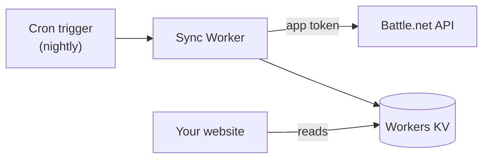

# wow-armoury-sync

A small Cloudflare Worker that copies your World of Warcraft characters from Blizzard's Battle.net API into Cloudflare Workers KV once a night. A website can then show them in an Armory-style view without calling Blizzard on every page load.

It handles both **retail** and **WoW Forever** characters. It powers the armoury pages on [nerdz.cloud](https://nerdz.cloud).

## How it works



1. Cloudflare wakes the Worker on a schedule. There's no public URL: any web request gets a 404.
2. The Worker gets an app token from Battle.net using the client credentials flow, so no player login is involved.
3. For each character it fetches the profile, then fetches these sections in parallel: equipment, statistics, specialisations, character media, PvP summary, raid progress and (retail only) Mythic+ profile.
4. It shapes those responses into **views**: small JSON documents holding exactly what an Armory page shows, already formatted. Your site reads a view and renders it, without knowing anything about Blizzard's response formats.
5. It writes the views to KV, plus an index your site can use to list characters.

A bad night never wipes good data. If Blizzard's API fails, the character's previous view is kept and its summary is marked with the error.

## What gets stored

| KV key | Contents |
| --- | --- |
| `index` | `schemaVersion`, `updatedAt` and one summary per character (see below) |
| `view:v1:{key}:character` | The Character view for one character: gear, stats, specs, Mythic+, raids, PvP |
| `ref:{namespace}:item-icon:{itemId}` | An item's icon URL. Icons never change, so each is fetched once and reused. |
| `ref:{namespace}:class-specs:{classId}` | A class's specialisation names, in Blizzard's order |

A character's `{key}` is `retail:{region}:{realm}:{name}` or `forever:{region}:{name}-{surname}`.

### Summaries

Each entry in `index.characters` looks like this:

```json
{
  "key": "retail:us:barthilas:cònsecrator",
  "game": "retail",
  "status": "ok",
  "route": ["retail", "barthilas", "cònsecrator"],
  "name": "Cònsecrator",
  "surname": null,
  "realm": "Barthilas",
  "ruleset": null,
  "level": 80,
  "race": "Blood Elf",
  "characterClass": "Paladin",
  "spec": "Retribution",
  "faction": "HORDE",
  "itemLevel": 81,
  "title": "Vengeance Incarnate",
  "guild": "Big Chur",
  "achievementPoints": 11940,
  "inset": "https://render.worldofwarcraft.com/…-inset.jpg",
  "lastSuccessAt": "2026-11-16T14:17:00.000Z"
}
```

- `route` is a ready-made address for the character's page: lowercase, accents kept, not URL-encoded.
- `realm` is set for retail characters; `ruleset` (the WoW Forever play style, such as `"Normal"`) for Forever characters.
- `inset` is a portrait image. Forever characters have none, so it falls back to the avatar.

`status` is one of:

| Status | Meaning |
| --- | --- |
| `ok` | Synced on the latest run |
| `not-listed` | Blizzard doesn't list the character (yet). WoW Forever characters only appear from **level 10**, after logging out. The sync tries again each night. Only `key`, `game`, `status`, `route`, `name` and `surname` are present. |
| `error` | The API call failed. The previous view and summary are kept, with an `error` message added. `lastSuccessAt` says how old the data is. |

### The Character view

A trimmed example:

```json
{
  "schemaVersion": 1,
  "game": "forever",
  "fetchedAt": "2026-11-16T14:17:00.000Z",
  "render": "https://render.worldofwarcraft.com/…-main-raw.png",
  "equipment": [{
    "slot": "WAIST", "slotName": "Waist", "name": "Blackened Defias Belt",
    "quality": "RARE", "itemLevel": 22, "icon": "https://render.worldofwarcraft.com/….jpg",
    "binding": "Binds when picked up", "inventoryType": "Waist", "subclass": null,
    "armor": "50 Armor",
    "stats": [{ "text": "+18 Attack Power", "negated": false, "equipBonus": true }],
    "enchantments": [], "sockets": [], "spells": [],
    "set": "Defias Leather (1/5)", "weapon": null,
    "requirement": "Requires Level 17", "description": null, "nameDescription": null
  }],
  "stats": [{ "label": "Health", "value": "545" }, { "label": "Critical strike", "value": "4.6%" }],
  "specs": [{ "name": "Beast Mastery", "active": true, "heroTalent": null, "pvpTalents": [], "spentPoints": 14 }],
  "mythicPlus": null,
  "raids": null,
  "pvp": { "honorLevel": null, "honorableKills": 0, "rank": 0 }
}
```

- **`equipment`:** one entry per equipped item, keyed by Blizzard's slot type (`HEAD`, `FINGER_1`, `MAIN_HAND`, and on Forever `RANGED` and `AMMO`). Every text field is Blizzard's own display string. `icon` is `null` when the icon hasn't been fetched yet. `negated` marks a stat that doesn't apply to the character's spec (the Armory greys these out). `equipBonus` marks a secondary stat (the Armory shows these in green).
- **`stats`:** already formatted. Retail shows health, power, the highest primary stat, stamina, crit, haste, mastery and versatility; Forever shows health, power, the highest primary stat, stamina, crit and armour.
- **`specs`:** for retail, every specialisation of the class, with the active one marked. Forever reports talent points instead, so the tree with the most points is the active one.
- **`mythicPlus`:** `{ "rating": number | null }` for retail, `null` for Forever.
- **`raids`:** progress for the newest expansion the character has raided in, or `null`.

A section the API doesn't return becomes empty (an empty list, or `null`) rather than failing the character.

### Schema versions

`index.schemaVersion` is the version of the views the sync writes. Changes to a view's shape get a new version number in the key (`view:v2:…`). When that happens, the sync writes the old and new versions side by side for a while, so a site can move over at its own pace. Fields are only ever added to the index, never removed or renamed.

### Upgrading from v1.x

v1.x stored Blizzard's raw responses under `character:{key}` and icons under `icon:{namespace}:{id}`. v2 writes neither. After the first v2 run, delete the old keys:

```sh
npx wrangler kv key list --binding WOW_ARMORY --remote --prefix character: > old-character.json
npx wrangler kv key list --binding WOW_ARMORY --remote --prefix icon: > old-icon.json
```

Each file is a list of `{ "name": … }` objects. Turn it into a plain list of key names, then pass that to `npx wrangler kv bulk delete <file> --binding WOW_ARMORY --remote`.

## Set up your own

You need a [Cloudflare](https://dash.cloudflare.com/) account, [Node.js](https://nodejs.org/) 20 or newer, and a Battle.net account.

### 1. Create a Battle.net API client

1. Sign in to the [Blizzard developer portal](https://develop.battle.net/access/clients) and create a client.
2. You can set the redirect URL to anything, because this Worker never uses the login flow.
3. Keep the **Client ID** and **Client Secret** for step 4.

### 2. Get the code

```sh
git clone https://github.com/gavinmcfall/wow-armoury-sync.git
cd wow-armoury-sync
npm install
```

Wrangler (Cloudflare's command line tool) is installed as a dev dependency. Sign in with `npx wrangler login`, or set `CLOUDFLARE_API_TOKEN` to an API token that can edit Workers and KV.

### 3. Point it at your account and storage

In `wrangler.jsonc`:

1. Set `account_id` to your Cloudflare account ID. It's shown in the dashboard sidebar, or by `npx wrangler whoami`.
2. Create a KV namespace:

   ```sh
   npx wrangler kv namespace create WOW_ARMORY
   ```

3. Put the `id` it prints into the `kv_namespaces` entry.

Optionally, change the schedule in `triggers.crons`. Cron times are **UTC**. The default, `17 14 * * *`, runs at 14:17 UTC, which is overnight in New Zealand.

### 4. Add your Battle.net credentials

For the deployed Worker, store them as Worker secrets. Each command prompts for the value, so it never appears in your shell history:

```sh
npx wrangler secret put BNET_CLIENT_ID
npx wrangler secret put BNET_CLIENT_SECRET
```

For local runs, create a file called `.dev.vars` in the project folder. Git ignores it.

```ini
BNET_CLIENT_ID=your-client-id
BNET_CLIENT_SECRET=your-client-secret
```

### 5. List your characters

Edit `src/characters.js`. Write names and realms in **lowercase**, with any accents kept, because that's how the API expects them.

```js
export const REGION = "us"; // us, eu, kr or tw

// Retail: realm slug and name.
export const RETAIL = [
  { realm: "barthilas", name: "cònsecrator" },
];

// WoW Forever has no realms. Characters are identified by first name and surname.
export const FOREVER = [
  { name: "recurve", surname: "ravenholt" },
];
```

To check that the API can see your characters before you deploy, run the probe script:

```sh
node --env-file=.dev.vars scripts/forever-probe.mjs
```

It prints the status code from each endpoint (200 means found, 404 means not listed) and a one-line summary of each character. It never prints your credentials.

### 6. Test it, try it, deploy it

```sh
npm test          # unit tests with a fake Battle.net API and a fake KV
npm run dev       # run the Worker locally
```

While `npm run dev` is running, trigger the nightly job by opening <http://127.0.0.1:8787/cdn-cgi/local/scheduled>. The Worker logs a line like `{"event":"armory-sync","counts":{"ok":13,"not-listed":8},"refs":{"hits":0,"fetched":160,"skipped":0}}`.

> The KV binding sets `"remote": true`, so local runs read and write your **real** KV namespace. That lets you check the results with `npx wrangler kv key get index --binding WOW_ARMORY --remote`. Remove that line if you'd rather use local, throwaway storage.

When it looks right:

```sh
npm run deploy
```

From then on it runs on its own every night. You can see each run's logs under **Workers & Pages → your Worker → Logs** in the Cloudflare dashboard.

## Reading the data from your site

If your site also runs on Cloudflare (Workers, or Pages with Functions), bind the same KV namespace to it and read the keys:

```js
const index = await env.WOW_ARMORY.get("index", "json");
const view = await env.WOW_ARMORY.get(`view:v1:${index.characters[0].key}:character`, "json");
```

Elsewhere, read KV through the [Cloudflare REST API](https://developers.cloudflare.com/api/resources/kv/subresources/namespaces/subresources/values/methods/get/) with a read-only token.

## Project layout

| Path | Purpose |
| --- | --- |
| `src/index.js` | Worker entry point: the scheduled handler |
| `src/sync.js` | The sync: fetching, error handling, KV writes |
| `src/views/character.js` | Builds the Character view from raw API responses |
| `src/views/summary.js` | Builds the index summaries |
| `src/refs.js` | The reference-data cache (`ref:` keys) |
| `src/blizzard.js` | Battle.net API client: app token, retry once on rate limits or server errors |
| `src/characters.js` | The characters to track |
| `scripts/forever-probe.mjs` | Checks which endpoints answer for each character |
| `scripts/capture-fixtures.mjs` | Refreshes the real API responses the tests use |
| `test/` | Unit tests (Node's built-in test runner) and their fixtures |

## Notes

- **Limits:** each character costs about 8 API calls, plus one call per item icon (and per class, for retail) the first time it's seen. New reference lookups are capped at 2,000 a night; anything over the cap is fetched on a later night. A few dozen characters fits comfortably within Cloudflare's and Blizzard's limits.
- **Blizzard's terms:** data from the Battle.net API is covered by [Blizzard's Developer API Terms of Use](https://www.blizzard.com/legal/a2989b50-5f16-43b1-abec-2ae17cc09dd6/blizzard-developer-api-terms-of-use).
- This isn't affiliated with or endorsed by Blizzard Entertainment. World of Warcraft is a trademark of Blizzard Entertainment.

## Licence

[MIT](LICENSE).
